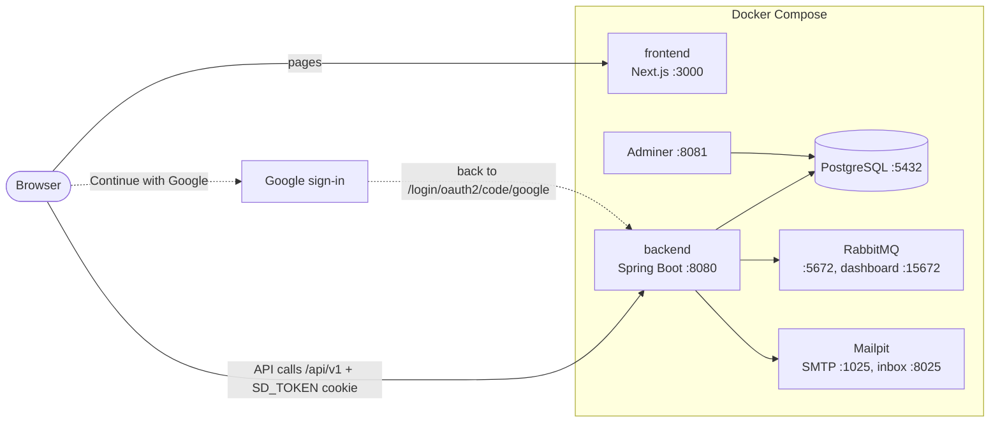

# SwiftDrop

SwiftDrop is a parcel delivery and courier management system for Sri Lanka, built as a university
group project by a team of 9. Customers send parcels now and then. Merchants (online shops) send orders
regularly and collect cash on delivery. Couriers pick up and deliver parcels. An admin (the dispatcher)
approves merchants, assigns parcels to couriers and watches deliveries across all 25 districts.

This repository is the starting point for the whole project. It runs everything with Docker Compose.

| Repository | What it contains |
|---|---|
| [swiftdrop-deploy](https://github.com/SwiftDrop-Project/swiftdrop-deploy) (this one) | `docker-compose.yml`, the shared `.env.example`, project docs |
| [swiftdrop-backend](https://github.com/SwiftDrop-Project/swiftdrop-backend) | Spring Boot API (Java 21), database migrations, `API.md` (the API contract) |
| [swiftdrop-frontend](https://github.com/SwiftDrop-Project/swiftdrop-frontend) | Next.js web app, `DESIGN.md` (the design system) |

## Contents

1. [What works today](#what-works-today)
2. [Architecture](#architecture)
3. [Prerequisites](#prerequisites)
4. [Get the code](#get-the-code)
5. [Environment setup](#environment-setup)
6. [Option A: run everything in Docker](#option-a-run-everything-in-docker)
7. [Option B: development mode](#option-b-development-mode)
8. [Docker cheat-sheet](#docker-cheat-sheet)
9. [Viewing the database in Adminer](#viewing-the-database-in-adminer)
10. [What is shared through Git and what stays on your laptop](#what-is-shared-through-git-and-what-stays-on-your-laptop)
11. [Google sign-in setup](#google-sign-in-setup)
12. [Troubleshooting](#troubleshooting)
13. [Team workflow](#team-workflow)
14. [Roadmap](#roadmap)

## What works today

- Sign up as a customer or a merchant, with a mobile number or email and a password.
- Log in with a mobile number or email. "Keep me logged in" keeps you logged in for 7 days.
- "Continue with Google" for login and sign-up. New Google users add their mobile number (and business
  details for merchants) on a "Finish setting up your account" page.
- Merchants wait for approval. The admin approves or rejects them under **Merchants**.
- A home page and menu for each role: customer, merchant, courier and admin. Menu items that are not
  built yet show a "coming soon" screen.
- Seed accounts: one admin, plus demo customer, merchant and courier accounts for testing.

## Architecture

| Part | Technology | Notes |
|---|---|---|
| Backend | Spring Boot 4 (Java 21) | One modular monolith: one package per business area (auth, users, merchants, parcels, ...). REST API under `/api/v1`. |
| Frontend | Next.js 16 (React 19, TypeScript, Tailwind CSS) | The browser calls the backend directly, with the login cookie. |
| Database | PostgreSQL 17 | Schema created by Flyway migrations in the backend repo. |
| Message broker | RabbitMQ 4 | For events between backend modules. The backend connects to it; no events are sent yet. |
| Email | Mailpit | A fake inbox for development. Nothing sends email yet. |
| Database viewer | Adminer | Look at tables in the browser. |



## Prerequisites

Install these, then check each one in a new terminal (Git Bash or PowerShell).

| Tool | Needed for | Check |
|---|---|---|
| Git (includes Git Bash) | Everything | `git --version` |
| Docker Desktop (WSL 2 engine) | Everything | `docker --version` and `docker compose version` |
| Java 21 (JDK, e.g. Eclipse Temurin 21) | Option B only (backend on your laptop) | `java -version` |
| Node.js 22 LTS (includes npm) | Option B only (frontend on your laptop) | `node --version` and `npm --version` |

Docker Desktop must be **running** (whale icon in the taskbar says "Engine running") before any
`docker` command works. You don't need to install Maven: the backend includes the Maven wrapper (`mvnw`).

## Get the code

Clone the three repositories into **one folder, side by side**. `docker-compose.yml` finds the code
through `../swiftdrop-backend` and `../swiftdrop-frontend`, so keep the folder names as they are.

```bash
mkdir swiftdrop
cd swiftdrop
git clone https://github.com/SwiftDrop-Project/swiftdrop-deploy.git
git clone https://github.com/SwiftDrop-Project/swiftdrop-backend.git
git clone https://github.com/SwiftDrop-Project/swiftdrop-frontend.git
```

These commands are the same in Git Bash and PowerShell. You now have:

```text
swiftdrop/
├── swiftdrop-deploy/
├── swiftdrop-backend/
└── swiftdrop-frontend/
```

## Environment setup

Settings and passwords live in a `.env` file. Each laptop has its own. It is never committed.

**1. Copy the example file.**

Git Bash:

```bash
cd swiftdrop-deploy
cp .env.example .env
```

PowerShell:

```powershell
cd swiftdrop-deploy
Copy-Item .env.example .env
```

**2. Generate a JWT secret** (the key that signs login tokens; at least 32 characters).

Git Bash:

```bash
openssl rand -base64 48
```

PowerShell:

```powershell
$b = New-Object byte[] 48; [Security.Cryptography.RandomNumberGenerator]::Create().GetBytes($b); [Convert]::ToBase64String($b)
```

**3. Open `.env` and fill it in.**

```bash
notepad .env
```

Paste the generated value after `JWT_SECRET=`. Change the `change-me` passwords to your own. Don't use
the `$` character in any value: Docker Compose treats it as a variable.

| Variable | Value in `.env.example` | What it is |
|---|---|---|
| `POSTGRES_DB` | `swiftdrop` | Database name |
| `POSTGRES_USER` | `swiftdrop` | Database user |
| `POSTGRES_PASSWORD` | `change-me` | Database password. Used only when the database is first created (see [Troubleshooting](#troubleshooting)). |
| `RABBITMQ_USER` | `swiftdrop` | RabbitMQ user |
| `RABBITMQ_PASSWORD` | `change-me` | RabbitMQ password. Also fixed after the first start. |
| `JWT_SECRET` | empty | Signs login tokens. At least 32 characters. The backend refuses to start without it. |
| `JWT_EXPIRY_MINUTES` | `60` | How long a login lasts without "Keep me logged in" |
| `JWT_REMEMBER_ME_DAYS` | `7` | How long a login lasts with "Keep me logged in" (and with Google) |
| `ADMIN_EMAIL` | `admin@swiftdrop.lk` | The admin account, created on the first start |
| `ADMIN_PASSWORD` | `change-me-123` | Password for the admin account |
| `SEED_DEMO_USERS` | `true` | `true` creates the demo customer, merchant and courier accounts |
| `DEMO_PASSWORD` | `Demo12345` | Password for the demo accounts |
| `FRONTEND_URL` | `http://localhost:3000` | Where the frontend runs. The backend allows browser calls only from here and redirects here after Google sign-in. |
| `NEXT_PUBLIC_API_URL` | `http://localhost:8080/api/v1` | Where the browser finds the API. Built into the frontend image. |
| `NEXT_PUBLIC_GOOGLE_LOGIN_ENABLED` | `false` | `true` shows "Continue with Google". Built into the frontend image. |
| `GOOGLE_CLIENT_ID` | empty | From Google Cloud Console. See [Google sign-in setup](#google-sign-in-setup). |
| `GOOGLE_CLIENT_SECRET` | empty | From Google Cloud Console. Share privately, never commit. |

Admin and demo accounts are created only if their email doesn't exist yet. Changing `ADMIN_PASSWORD`
or `DEMO_PASSWORD` later does not change existing accounts.

## Option A: run everything in Docker

Use this for the demo, or when you work on only one side and want the rest to just run.

From the `swiftdrop-deploy` folder:

```bash
docker compose up -d --build
```

The first build downloads a lot and takes several minutes. Later starts take seconds. Check that
everything is up:

```bash
docker compose ps
```

Wait until the backend has started (press `Ctrl+C` to stop watching; the backend keeps running):

```bash
docker compose logs -f backend
```

Look for `Started SwiftdropBackendApplication`. Then check the health endpoint.

Git Bash:

```bash
curl http://localhost:8080/actuator/health
```

PowerShell:

```powershell
curl.exe http://localhost:8080/actuator/health
```

It should print `{"status":"UP"}`.

### URLs and ports

| What | URL or address | Login |
|---|---|---|
| SwiftDrop web app | http://localhost:3000 | See demo accounts below |
| API | http://localhost:8080/api/v1 | The web app logs you in |
| API docs (Swagger UI) | http://localhost:8080/swagger-ui.html | Log in there with `POST /api/v1/auth/login` |
| Backend health | http://localhost:8080/actuator/health | None |
| Fake email inbox (Mailpit) | http://localhost:8025 | None |
| RabbitMQ dashboard | http://localhost:15672 | `RABBITMQ_USER` / `RABBITMQ_PASSWORD` |
| Adminer (database viewer) | http://localhost:8081 | See [Adminer](#viewing-the-database-in-adminer) |
| PostgreSQL (for desktop DB tools) | `localhost:5432` | `POSTGRES_USER` / `POSTGRES_PASSWORD` |
| RabbitMQ (AMQP) | `localhost:5672` | Used by the backend |
| Mailpit SMTP | `localhost:1025` | Used by the backend |

### Demo accounts

Log in at http://localhost:3000/login with the email or the mobile number. The values below are the
ones from `.env.example`. If you changed the passwords in `.env`, use yours.

| Role | Email | Mobile | Password | Home page |
|---|---|---|---|---|
| Admin | `admin@swiftdrop.lk` (`ADMIN_EMAIL`) | `0770000000` | `ADMIN_PASSWORD` (`change-me-123`) | `/dispatcher` |
| Customer | `customer@swiftdrop.lk` | `0770000001` | `DEMO_PASSWORD` (`Demo12345`) | `/customer` |
| Merchant (approved) | `merchant@swiftdrop.lk` | `0770000002` | `DEMO_PASSWORD` (`Demo12345`) | `/merchant` |
| Courier | `courier@swiftdrop.lk` | `0770000003` | `DEMO_PASSWORD` (`Demo12345`) | `/courier` |

Demo accounts exist only when `SEED_DEMO_USERS=true`. To try the merchant approval flow, register a
new merchant at http://localhost:3000/register, then log in as admin and open **Merchants**.

## Option B: development mode

Use this while you write code. The database, RabbitMQ, Mailpit and Adminer run in Docker. The backend
and frontend run on your laptop, so your changes show up without rebuilding Docker images.

The backend and frontend use the same ports as their Docker containers. If you used Option A
before, stop those two containers first:

```bash
docker compose stop backend frontend
```

**1. Start the infrastructure** (from `swiftdrop-deploy`):

```bash
docker compose up -d postgres rabbitmq mailpit adminer
```

**2. Set up and start the backend** (in a new terminal).

Git Bash:

```bash
cd ../swiftdrop-backend
cp .env.example .env
notepad .env
./mvnw spring-boot:run
```

PowerShell:

```powershell
cd ..\swiftdrop-backend
Copy-Item .env.example .env
notepad .env
.\mvnw.cmd spring-boot:run
```

In `swiftdrop-backend/.env`, use the **same values** as in `swiftdrop-deploy/.env`:

| `swiftdrop-backend/.env` | Same value as `swiftdrop-deploy/.env` |
|---|---|
| `DB_PASSWORD` | `POSTGRES_PASSWORD` |
| `RABBITMQ_PASSWORD` | `RABBITMQ_PASSWORD` |
| `JWT_SECRET` | `JWT_SECRET` |
| `ADMIN_EMAIL`, `ADMIN_PASSWORD`, `DEMO_PASSWORD` | same names |
| `GOOGLE_CLIENT_ID`, `GOOGLE_CLIENT_SECRET` | same names (only if you use Google sign-in) |

The backend is ready when the log shows `Started SwiftdropBackendApplication`. It runs on
http://localhost:8080.

**3. Set up and start the frontend** (in another new terminal).

Git Bash:

```bash
cd ../swiftdrop-frontend
cp .env.example .env.local
npm install
npm run dev
```

PowerShell:

```powershell
cd ..\swiftdrop-frontend
Copy-Item .env.example .env.local
npm install
npm run dev
```

Open http://localhost:3000. Set `NEXT_PUBLIC_GOOGLE_LOGIN_ENABLED=true` in `.env.local` only if the
backend has Google credentials. Restart `npm run dev` after changing `.env.local`.

Stop the backend or frontend with `Ctrl+C` in its terminal. Stop the infrastructure with
`docker compose stop`.

## Docker cheat-sheet

Run these from the `swiftdrop-deploy` folder. They are the same in Git Bash and PowerShell.

| Command | What it does |
|---|---|
| `docker compose up -d` | Starts everything in the background. Creates containers that don't exist yet. |
| `docker compose up -d postgres rabbitmq mailpit adminer` | Starts only the infrastructure (Option B). |
| `docker compose up -d --build` | Rebuilds the backend and frontend images from your current code, then starts everything. |
| `docker compose up -d --build backend` | Rebuilds and restarts only the backend. Use `frontend` for the frontend. |
| `docker compose ps` | Shows which containers are running and healthy. |
| `docker compose logs -f backend` | Follows the backend log. `Ctrl+C` stops watching, not the container. |
| `docker compose logs --tail 100 backend` | Shows the last 100 log lines. |
| `docker compose restart backend` | Restarts the backend container without rebuilding. |
| `docker compose stop` | Stops all containers. Nothing is deleted. |
| `docker compose start` | Starts stopped containers again. |
| `docker compose down` | Stops and removes the containers. The database data is kept. |
| `docker compose down -v` | Removes the containers **and the database**. All data is lost. The admin and demo accounts are created again on the next start. |
| `docker compose exec postgres psql -U swiftdrop -d swiftdrop` | Opens an SQL prompt in the database. In Git Bash, put `winpty` in front. Type `\q` to leave. |

**Reset the database** (delete all data and start fresh):

```bash
docker compose down -v
docker compose up -d
```

In Option B, run `docker compose up -d postgres rabbitmq mailpit adminer` instead of the last line,
then restart the backend so Flyway creates the tables again.

## Viewing the database in Adminer

Open http://localhost:8081 and log in with:

| Field | Value |
|---|---|
| System | PostgreSQL |
| Server | `postgres` |
| Username | your `POSTGRES_USER` (`swiftdrop`) |
| Password | your `POSTGRES_PASSWORD` |
| Database | your `POSTGRES_DB` (`swiftdrop`) |

The server is `postgres`, not `localhost`: Adminer runs inside Docker and reaches the database by its
service name. The table `flyway_schema_history` lists the migrations that have run.

## What is shared through Git and what stays on your laptop

| Shared through Git (everyone gets it with `git pull`) | Stays on your laptop only |
|---|---|
| Source code of all three repositories | `.env` files (`swiftdrop-deploy/.env`, `swiftdrop-backend/.env`) and `swiftdrop-frontend/.env.local` |
| `.env.example` files (names and safe example values) | Real passwords, `JWT_SECRET`, the Google client secret |
| `docker-compose.yml`, Dockerfiles | Docker images and containers |
| Database migrations (`swiftdrop-backend/src/main/resources/db/migration`) | The database itself (Docker volume `swiftdrop-deploy_pgdata`): every account and row you create |
| `API.md`, `DESIGN.md`, design images | `node_modules`, `.next`, `target` (build output) |

What this means:

- Accounts you register exist only on your laptop. Teammates have their own.
- Schema changes reach everyone as migrations. They run automatically when the backend starts.
- Share real secrets only in the team's private chat. Never put them in a commit, an issue or a PR.

## Google sign-in setup

"Continue with Google" is optional. Without the Google values the app starts normally and the button
is hidden. One person creates the Google client once and shares the values with the team.

### 1. Create the Google Cloud project

1. Open https://console.cloud.google.com and sign in with the team's Google account.
2. Click the project picker at the top, then **New project**.
3. Name it `SwiftDrop` and click **Create**. Make sure the new project is selected.

### 2. Set up the consent screen (Testing mode)

1. Open **APIs & Services** → **OAuth consent screen** (shown as **Google Auth Platform** in newer
   consoles) and click **Get started**.
2. App name: `SwiftDrop`. User support email: the team's email.
3. Audience: **External**.
4. Contact email: the team's email. Accept the policy and click **Create**.
5. Leave the publishing status on **Testing**. SwiftDrop only asks for the basic `openid`, `email` and
   `profile` scopes, so no Google review is needed.

### 3. Add test users

In Testing mode only listed accounts can sign in.

1. Open **Audience** (or **OAuth consent screen** → **Test users**).
2. Click **Add users** and add the Gmail address of every teammate, and any account you use in the demo.

### 4. Create the Web client

1. Open **Clients** (or **Credentials** → **Create credentials** → **OAuth client ID**).
2. Application type: **Web application**. Name: `SwiftDrop local`.
3. Under **Authorized redirect URIs**, click **Add URI** and enter exactly:

   ```text
   http://localhost:8080/login/oauth2/code/google
   ```

   Use `http`, `localhost` (not `127.0.0.1`), port `8080` and no slash at the end.
   **Authorized JavaScript origins** can stay empty.
4. Click **Create**. Copy the **Client ID** and the **Client secret** straight away. Newer consoles show
   the secret only once. You can also download the JSON file; keep it outside the repositories.

### 5. Put the values in your `.env` files

| How you run SwiftDrop | File | Values |
|---|---|---|
| Option A (all in Docker) | `swiftdrop-deploy/.env` | `GOOGLE_CLIENT_ID`, `GOOGLE_CLIENT_SECRET`, `NEXT_PUBLIC_GOOGLE_LOGIN_ENABLED=true` |
| Option B (development) | `swiftdrop-backend/.env` | `GOOGLE_CLIENT_ID`, `GOOGLE_CLIENT_SECRET` |
| Option B (development) | `swiftdrop-frontend/.env.local` | `NEXT_PUBLIC_GOOGLE_LOGIN_ENABLED=true` |

Then restart. Option A (the frontend must be rebuilt because the flag is built into it):

```bash
docker compose up -d --build backend frontend
```

Option B: stop and start `./mvnw spring-boot:run` and `npm run dev` again.

### 6. Share the values safely

- The whole team uses the same client. Send the Client ID and Client secret to teammates in the team's
  private chat.
- Never commit the secret, and never paste it into an issue, a PR or a screenshot. `.env` and
  `.env.local` are git-ignored for this reason.
- If the secret leaks, create a new secret for the client in Google Cloud Console, delete the old one,
  and send the new value to the team.

### How the flow works

1. The user clicks **Continue with Google** on `/login` or `/register`. The browser goes to
   `http://localhost:8080/oauth2/authorization/google`, and the backend sends it on to Google.
2. After the user agrees, Google sends the browser back to `http://localhost:8080/login/oauth2/code/google`.
3. The backend accepts only emails that Google has verified. It finds the account by Google ID, then
   by email. A password account with the same email is linked and keeps its role. A new user becomes a
   customer with status `PROFILE_INCOMPLETE`.
4. The backend sets the login cookie and redirects to `http://localhost:3000/auth/callback`.
5. `PROFILE_INCOMPLETE` users go to **Finish setting up your account** (`/register/complete`). There they
   choose Customer or Merchant and add their mobile number (and business details for merchants).
   Customers go straight to their home page. Merchants wait for approval like any new merchant.
6. On any failure the browser lands on `http://localhost:3000/login?error=...` with a message.

The details are in the **Google sign-in** section of
[swiftdrop-backend/API.md](https://github.com/SwiftDrop-Project/swiftdrop-backend/blob/dev/API.md).

### Google troubleshooting

| What you see | Why | Fix |
|---|---|---|
| No "Continue with Google" button | `NEXT_PUBLIC_GOOGLE_LOGIN_ENABLED` is not `true`, or the frontend was not rebuilt or restarted after the change | Set it to `true`. Option A: `docker compose up -d --build frontend`. Option B: restart `npm run dev`. |
| After clicking, a page from `localhost:8080` says `NOT_FOUND` | The backend has no Google values. It needs both `GOOGLE_CLIENT_ID` and `GOOGLE_CLIENT_SECRET`. | Add both to the right `.env` file and restart the backend. |
| Google says **Error 400: redirect_uri_mismatch** | The redirect URI in Google Cloud Console is not exactly `http://localhost:8080/login/oauth2/code/google` | Fix it in the client settings. Changes can take a few minutes. |
| Google says **Error 401: invalid_client** | Wrong Client ID or secret, or extra spaces or quotes in `.env` | Copy the values again, with nothing after them on the line. Restart the backend. |
| Google says **Access blocked** or **has not completed the Google verification process** | Your Google account is not a test user | Add it under **Audience** → **Test users**. |
| Back on the login page with "We couldn't sign you in with Google" | You cancelled, waited more than 5 minutes on Google's pages, the email is not verified by Google, or the email belongs to an account already linked to a different Google account | Try again. If it keeps happening, check `docker compose logs backend` (Option A) or the backend terminal for lines starting with `Google sign-in`. |
| "Your account is waiting for approval" after Google | The account is a merchant that the admin has not approved yet | Log in as admin and approve it under **Merchants**. |
| "Finish setting up your account" keeps appearing | The account still has status `PROFILE_INCOMPLETE` | Fill in and submit the form. To switch accounts, click **Use another account**. |
| The password login fails for an account created with Google | Accounts created with Google have no password | Use **Continue with Google**. |

## Troubleshooting

| Problem | What you see | Fix |
|---|---|---|
| Docker is not running | `error during connect`, `Cannot connect to the Docker daemon`, or `docker` hangs | Start Docker Desktop and wait for "Engine running". Then run the command again. |
| A port is already in use | `Bind for 0.0.0.0:5432 failed: port is already allocated` (or 8080, 3000, 5672, 8025, 8081) | Something else uses that port. Often a locally installed PostgreSQL (5432), or the backend/frontend from Option B and Docker running at the same time (8080, 3000). Stop the other program, or stop the containers with `docker compose stop backend frontend`. |
| Find what uses a port | | PowerShell: `Get-NetTCPConnection -LocalPort 5432 -State Listen \| Select-Object OwningProcess`, then `Get-Process -Id <that number>`. Git Bash: `netstat -ano \| grep :5432` (the last column is the process ID). |
| Password changed after the first start | Backend log: `password authentication failed for user "swiftdrop"` | PostgreSQL keeps the password from the day the database was created. Put the old password back in `.env`, or [reset the database](#docker-cheat-sheet) (deletes all data). |
| RabbitMQ password changed after the first start | Backend log: `ACCESS_REFUSED - Login was refused` | Put the old password back, or recreate RabbitMQ: `docker compose rm -s -f -v rabbitmq` then `docker compose up -d rabbitmq`. |
| Backend stops at startup about `JWT_SECRET` | `JWT_SECRET is missing` or `must be at least 32 characters long` | Generate one (see [Environment setup](#environment-setup)) and restart. |
| Option B passwords don't match | Backend log: `password authentication failed` | `DB_PASSWORD` in `swiftdrop-backend/.env` must equal `POSTGRES_PASSWORD` in `swiftdrop-deploy/.env`. |
| CORS error in the browser console, or you are logged out straight after logging in | `blocked by CORS policy`, or `/login` again after a successful login | Open the app at exactly `http://localhost:3000`, not `127.0.0.1`. `FRONTEND_URL` must be `http://localhost:3000` and `NEXT_PUBLIC_API_URL` must be `http://localhost:8080/api/v1`. Keep `COOKIE_SECURE=false` on `http`. Restart the backend after changing `FRONTEND_URL`; rebuild the frontend after changing `NEXT_PUBLIC_API_URL`. |
| Logged out everywhere after changing `JWT_SECRET` | Every page sends you to `/login` | Expected: old login cookies are no longer valid. Log in again. |
| Code changes don't show in Docker | The app looks like the old version | Docker runs the image built last time. Run `docker compose up -d --build backend frontend`. |
| A changed `NEXT_PUBLIC_...` value has no effect | The old URL or flag is still used | These values are built into the frontend. Option A: `docker compose up -d --build frontend`. Option B: restart `npm run dev`. |
| `Migration checksum mismatch` at backend start | Flyway error naming a `V..._*.sql` file | Someone edited a migration that already ran. Restore the file from Git (`git checkout dev -- <file>`). Changes always go in a new migration. |

## Team workflow

Each repository has two long-lived branches: `main` (release) and `dev` (integration).

1. Start from an up-to-date `dev` and create a feature branch:

   ```bash
   git switch dev
   git pull
   git switch -c feature/parcel-booking
   ```

2. Commit in small steps with this message style: `type(scope): what changed`.

   | Type | Use for | Example |
   |---|---|---|
   | `feat` | A new feature | `feat(auth): add login endpoint` |
   | `fix` | A bug fix | `fix(auth): keep phone format on register` |
   | `docs` | Documentation only | `docs: explain Option B setup` |
   | `test` | Tests only | `test(merchants): cover reject endpoint` |
   | `refactor` | Code change without new behaviour | `refactor(users): extract phone normaliser` |
   | `chore` | Build, tooling, dependencies | `chore: update Spring Boot` |

3. Before you push, run the checks: `./mvnw test` in the backend; `npm run lint` and `npm run build` in
   the frontend.
4. Push and open a pull request **into `dev`**:

   ```bash
   git push -u origin feature/parcel-booking
   ```

   A PR into `dev` needs **1 approval**.
5. When `dev` is stable, someone opens a PR from `dev` into `main`. It needs **2 approvals**.
6. If your change touches the API, update `swiftdrop-backend/API.md` in the same PR and tell the
   frontend team.

## Roadmap

These are planned and not built yet. Their menu items show a "coming soon" screen.

- **Parcels**: create deliveries (customers) and orders (merchants), list and search them.
- **Pricing**: delivery rates by district and weight.
- **Dispatch**: assign waiting parcels to couriers by zone.
- **Courier app**: today's pickups and deliveries, delivery history, status updates.
- **Tracking**: follow a parcel by tracking number, with or without an account.
- **Notifications**: emails (through Mailpit in development) and events on RabbitMQ.
- **Merchant integrations**: API keys and webhooks for online stores.
- **Reports**: deliveries, failed attempts and cash on delivery by day and zone.
- **Account pages**: addresses, payments, settings, password reset, help pages.
- **Admin**: courier and user management.
- **Deployment**: Kubernetes manifests (`k8s/`), CI checks on pull requests, HTTPS hosting.

## Repository contents

| Path | What it is |
|---|---|
| `docker-compose.yml` | All six services and how they connect |
| `.env.example` | Every variable Docker Compose needs, with safe example values |
| `docs/design/` | Design references for the UI |
| `docs/diagrams/`, `docs/test-reports/` | Reserved for diagrams and test reports (empty for now) |
| `k8s/` | Reserved for Kubernetes manifests (see [Roadmap](#roadmap)) |
